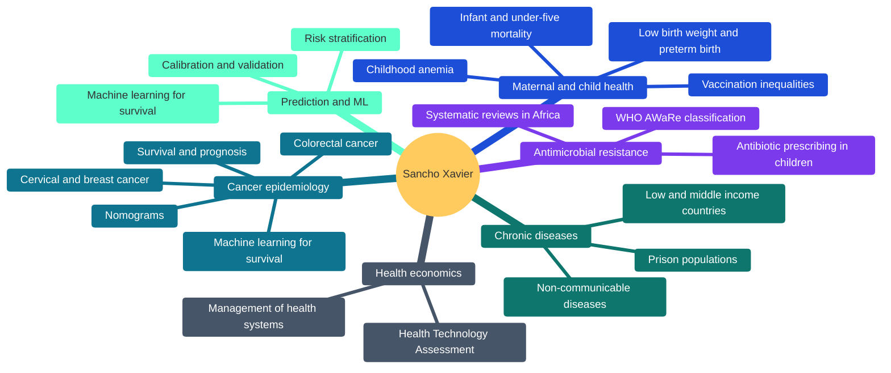
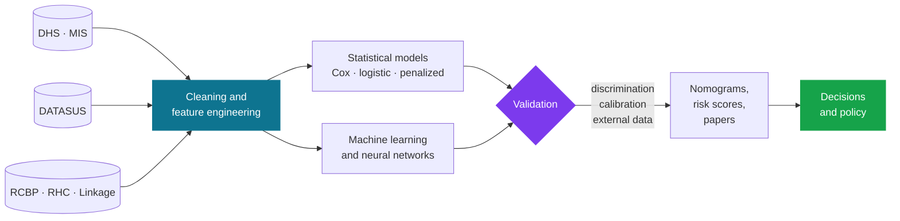
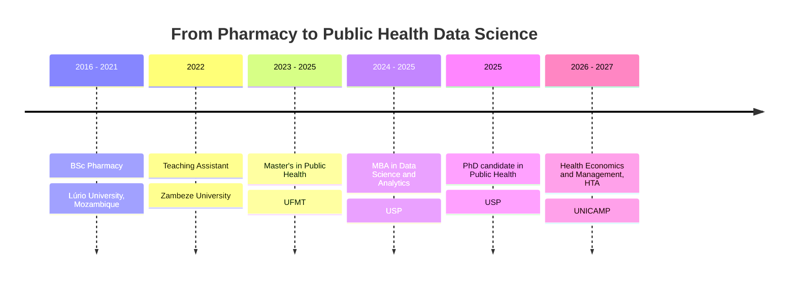

 

[**Hello**](#hello) · [**Research**](#research-interests) · [**Data**](#data-sources) · [**Survival ML**](#machine-learning-for-survival-analysis) · [**Toolbox**](#skills-and-toolbox) · [**Publications**](#selected-publications) · [**Contact**](#contact)

 

 

<table align="center">
<tr>
<td align="center" width="25%"><h2>39</h2>works on ORCID</td>
<td align="center" width="25%"><h2>9</h2>journals reviewed for</td>
<td align="center" width="25%"><h2>2</h2>settings Brazil and Africa</td>
<td align="center" width="25%"><h2>3</h2>degrees, plus an MBA and HTA in progress</td>
</tr>
</table>

---

## Hello

I'm a PhD candidate in Public Health at the University of São Paulo (Faculty of Public Health), studying the epidemiology of diseases and health conditions and what determines them. I came to this field through Pharmacy in Mozambique, moved to Brazil for my Master's, and kept adding tools along the way: first epidemiology, then data science, now health economics.

Most days I'm writing R or Python, cleaning messy health data, and trying to answer one question: *what does the evidence actually say, and how sure are we?*

> Quantitative methods are only useful if someone can trust, reproduce and act on the result.

**Quick facts**

- Master's in Public Health (UFMT) and MBA in Data Science and Analytics (USP)
- Working across two settings: Brazil (cancer, maternal and child health, hospital data) and Mozambique and sub-Saharan Africa (child health, antimicrobial resistance, chronic disease)
- Teaching Assistant in Pharmacy at Zambeze University

---

## Research interests

> **Main focus: cancer epidemiology.** Most of my current work is on cancer prognosis and surveillance: survival, risk stratification and trends in cervical, breast and colorectal cancer, using hospital-based and linked population-based data.

The red branch is my main focus, cancer epidemiology.

| Theme | What I study |
|---|---|
| **Cancer epidemiology** *(main focus)* | Survival and risk prediction in cervical, breast and colorectal cancer; incidence trends; stage at diagnosis; hospital and linked population-based data in Mato Grosso |
| **Maternal and child health** | Under-five mortality, low birth weight, preterm birth, childhood anemia, vaccination coverage and the social inequalities behind them |
| **Antimicrobial resistance and pharmacoepidemiology** | Antibiotic prescribing patterns in children, inappropriate use, the WHO AWaRe framework |
| **Non-communicable chronic diseases** | Prevalence and determinants across settings, from prisons in Mozambique to low and middle income countries |
| **Machine learning for survival analysis** | Random Survival Forest, Gradient Boosting Survival, penalized Cox and neural survival models, compared with classical Cox models (details [below](#machine-learning-for-survival-analysis)) |
| **Predictive modeling** | Nomograms, risk scores and machine learning, always judged on discrimination and calibration |
| **Health economics and HTA** | Evidence for decisions about technologies and health services - Cervival Cancer Screening - Real World Evidence, now my formal training at UNICAMP |

---

## Data sources

| Source | What it gives me |
|---|---|
| **DHS** | Demographic and Health Surveys: child mortality, anemia, vaccination, nutrition in sub-Saharan Africa |
| **MIS** | Malaria Indicator Surveys, used alongside DHS household data |
| **DATASUS** | Brazilian national systems for mortality, births and hospital admissions |
| **INCA, RCBP** | Population-based cancer registries: incidence, trends, survival |
| **FOSP, RHC** | Hospital-based cancer registry: stage at diagnosis, treatment, outcomes |
| **Linked administrative data** | Registry-to-mortality and other record linkages for follow-up |
| **Cohorts and field studies** | Birth cohorts and primary cross-sectional data |

---

## Machine learning for survival analysis

Time-to-event outcomes (death, progression, recovery) need models that handle censoring. I compare classical and machine learning approaches on the same data, and judge them by discrimination, calibration and clinical usefulness, not by a single metric.

| Family | Models |
|---|---|
| **Classical** | Kaplan-Meier, log-rank test, Cox proportional hazards, parametric survival models (Weibull, log-normal, AFT), Fine-Gray competing risks |
| **Penalized Cox** | LASSO, Ridge and Elastic Net Cox regression |
| **Tree ensembles** | Random Survival Forest, Gradient Boosting Survival (GBS), Extra Survival Trees, conditional inference forests |
| **Boosting** | Component-wise and likelihood-based boosted Cox models, XGBoost survival objectives |
| **Other ML** | Survival SVM, survival-adapted k-nearest neighbors |
| **Deep learning** | DeepSurv, DeepHit, Cox-Time, neural network discrete-time models |
| **Classification framing** | Logistic regression, Random Forest, XGBoost, LightGBM and neural networks for fixed-horizon mortality (for example in-hospital death) |

**Packages**

| Language | Packages |
|---|---|
| **R** | `survival`, `survminer`, `rms`, `glmnet`, `randomForestSRC`, `ranger`, `gbm`, `mboost`, `xgboost`, `mlr3proba`, `riskRegression`, `timeROC`, `pec`, `cmprsk`, `tidymodels`, `ggplot2` |
| **Python** | `scikit-survival`, `lifelines`, `pycox`, `scikit-learn`, `TensorFlow` and `Keras`, `Keras Tuner`, `XGBoost`, `LightGBM`, `SHAP`, `pandas`, `NumPy`, `matplotlib`, `seaborn` |

**How models are evaluated**

- **Discrimination:** Harrell's C-index, time-dependent AUC, integrated AUC
- **Calibration:** calibration plots at fixed horizons, calibration slope, integrated Brier score
- **Clinical usefulness:** decision curve analysis
- **Validation:** cross-validation, bootstrap optimism correction, temporal and external validation
- **Explainability:** permutation importance, SHAP values, partial dependence, nomograms for transparent models

---

## Skills and toolbox

### Data science

| Area | Tools and methods |
|---|---|
| **Programming** | R, Python, SQL, Git, Jupyter, R Markdown and Quarto |
| **Machine learning** | scikit-learn, penalized regression (LASSO, Ridge, Elastic Net), Random Forest, gradient boosting, XGBoost, LightGBM, hyperparameter tuning, cross-validation, class imbalance handling |
| **Deep learning and neural networks** | TensorFlow, Keras, Keras Tuner, feed-forward networks for tabular data, regularization, early stopping |
| **Data handling** | pandas, NumPy, tidyverse, data.table, missing data and imputation, feature engineering, record linkage |
| **Data visualization** | ggplot2, matplotlib, seaborn, plotly; Kaplan-Meier curves, forest plots, calibration plots, decision curves, nomograms, maps and trend charts |
| **Explainability** | SHAP, permutation importance, partial dependence |
| **Reproducibility** | Version control with Git and GitHub, documented pipelines, fixed seeds and environments |

### Statistics and epidemiology

| Area | Methods |
|---|---|
| **Survival analysis** | Kaplan-Meier, Cox models, parametric models, competing risks, time-to-event prediction |
| **Prediction modeling** | Logistic risk models, nomograms, discrimination, calibration, internal and external validation |
| **Study designs** | Cross-sectional, retrospective hospital-based, population-based, cohort |
| **Survey analysis** | Weighted analysis of complex survey data (DHS and MIS) |
| **Trends and forecasting** | Temporal trend analysis, joinpoint-style approaches, projections |
| **Evidence synthesis** | Systematic reviews and meta-analysis |
| **Health economics** | Health Technology Assessment (in training at UNICAMP) |

---

## Selected publications

Full list on [ORCID](https://orcid.org/0000-0001-9493-4098), [Google Scholar](https://scholar.google.com/citations?user=LX03TP4AAAAJ&hl=pt-BR), [Web of Science](https://www.webofscience.com/wos/author/record/GON-5675-2022). A selection by theme:

<b>Cancer prognosis and surveillance</b>

 

| Year | Title | Journal | |
|:-:|---|---|:-:|
| 2026 | Machine learning to predict mortality in women with breast cancer, Mato Grosso (linked registry and mortality data) | PLOS One | [DOI](https://doi.org/10.1371/journal.pone.0356621) |
| 2026 | Machine learning for risk stratification of in-hospital mortality in cervical cancer | BMC Cancer | [DOI](https://doi.org/10.1186/s12885-026-16771-z) |
| 2026 | Time to death from colorectal cancer in hospitalized patients, Legal Amazon | Rev. JRG de Estudos Acadêmicos | [DOI](https://doi.org/10.55892/jrg.v9i21.3639) |
| 2025 | Nomogram for overall survival in hospitalized cervical cancer patients | Discover Oncology | [DOI](https://doi.org/10.1007/s12672-025-02380-y) |
| 2025 | Nomogram for long-term prognosis of cervical cancer, population-based | BMC Cancer | [DOI](https://doi.org/10.1186/s12885-025-14056-5) |
| 2025 | Factors associated with advanced diagnosis of cervical cancer | ecancermedicalscience | [DOI](https://doi.org/10.3332/ecancer.2025.2045) |
| 2025 | Trend in cancer incidence in Mato Grosso, 2001 to 2018 | Archives of Public Health | [DOI](https://doi.org/10.1186/s13690-025-01503-9) |
| 2024 | Time to death from cervical cancer and its predictors: a survival approach | World J Surg Oncol | [DOI](https://doi.org/10.1186/s12957-024-03518-y) |

<b>Maternal and child health</b>

 

| Year | Title | Journal | |
|:-:|---|---|:-:|
| 2026 | Survival analysis of under-five mortality predictors, Mozambique DHS 2011 and 2022/23 | BMC Public Health | [DOI](https://doi.org/10.1186/s12889-026-27197-4) |
| 2026 | Machine learning models to predict childhood anemia in Mozambique | BMC Pediatrics | [DOI](https://doi.org/10.1186/s12887-026-06925-0) |
| 2025 | Trends and forecasting of preterm birth in Brazil, 2014 to 2023, projections to 2030 | BMC Pregnancy Childbirth | [DOI](https://doi.org/10.1186/s12884-025-08536-6) |
| 2025 | Predicting low birth weight with machine learning, Araraquara cohort | BMC Pregnancy Childbirth | [DOI](https://doi.org/10.1186/s12884-025-07351-3) |
| 2024 | Predictors of nutritional recovery time in severe acute malnutrition, Sofala | J Public Health | [DOI](https://doi.org/10.1093/pubmed/fdae049) |
| 2024 | Social inequalities in child development: low birth weight trends in Brazil | J Prevention | [DOI](https://doi.org/10.1007/s10935-024-00768-0) |

<b>Antimicrobial resistance and pharmacoepidemiology</b>

 

| Year | Title | Journal | |
|:-:|---|---|:-:|
| 2026 | Antibiotic prescribing in pediatric populations across Africa: systematic review and meta-analysis | Systematic Reviews | [DOI](https://doi.org/10.1186/s13643-026-03223-9) |
| 2026 | Antimicrobial resistance in Mozambique: the crisis we cannot afford to ignore | Lancet Reg Health Africa | [DOI](https://doi.org/10.1016/j.lanafr.2026.100053) |
| 2025 | An urgent call to combat antimicrobial resistance in sub-Saharan Africa | Discover Public Health | [DOI](https://doi.org/10.1186/s12982-025-01083-7) |
| 2024 | Antibiotic prescribing in children using the WHO AWaRe classification, Nampula | Scientific Reports | [DOI](https://doi.org/10.1038/s41598-024-72349-4) |
| 2022 | Inappropriate use of antibiotics and its predictors in hospitalized children | Antimicrob Resist Infect Control | [DOI](https://doi.org/10.1186/s13756-022-01115-w) |

<b>Chronic diseases, risk models and policy</b>

 

| Year | Title | Journal | |
|:-:|---|---|:-:|
| 2026 | A novel clinical nomogram for unfavorable tuberculosis treatment outcomes | J Epidemiol Glob Health | [DOI](https://doi.org/10.1007/s44197-026-00532-z) |
| 2026 | Structural inequalities and COVID-19 hospital mortality among traditional peoples, São Paulo | BMJ Public Health | [DOI](https://doi.org/10.1136/bmjph-2025-002679) |
| 2026 | Why are policies to combat undernutrition not effective in Mozambique? | Nature Communications | [DOI](https://doi.org/10.1038/s41467-026-69040-9) |
| 2025 | Chronic non-communicable diseases among prison inmates in Tete, Mozambique | BMC Public Health | [DOI](https://doi.org/10.1186/s12889-025-24387-4) |

---

## Affiliations and research groups

| Group | Role in my work |
|---|---|
| **AI for oncologic prognosis**, Faculty of Public Health, University of São Paulo | Machine learning and survival models for cancer outcomes |
| **VigiCan UFMT**, Cancer Surveillance in Mato Grosso, Federal University of Mato Grosso | Cancer surveillance, incidence trends, hospital and population-based cancer data |
| **Zambeze University**, Faculty of Health Sciences (Pharmacy) | Teaching and collaboration on health research in Mozambique |

---

## Peer review

43 verified peer reviews on Web of Science, and 35 review records on ORCID, across 21 journals. I review manuscripts for:

---

## Path so far

---

## GitHub analytics

---

<b>Away from the screen</b>

 

I read about social inequalities, development economics, data science and writing, and I follow what's new in epidemiology and health sciences. I also play chess. It rewards the same habits as research: patience, planning ahead, and admitting when a move was wrong.

---

## Contact

If your work touches cancer epidemiology, child health, antimicrobial resistance, HTA or applied machine learning, I'd like to hear from you. **I'm open to scientific collaborations**, including joint research projects, co-authored papers, data analysis and methodological support.

Turning data into evidence, and evidence into decisions.

